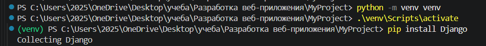
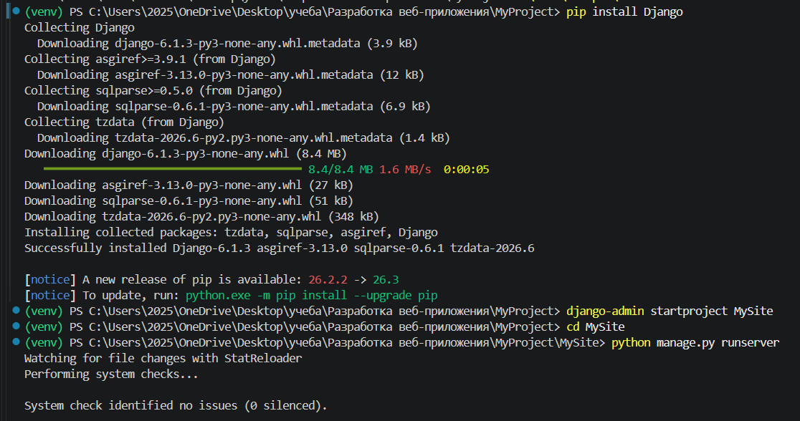
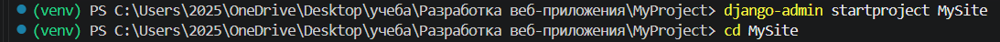
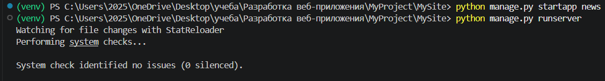
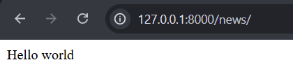
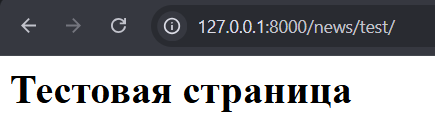

# Лабораторная работа № 1
## Создание виртуального окружения. Контроллеры и маршруты

**Выполнил:** _Халмышев Мансур Асланбекович_
**Группа:** _ПИЖ-б-о-25-1_
**Язык программирования:** Python / Django

---

## 1. Цель работы
Настроить виртуальное пространство (окружение). Разработать контроллеры приложения и организовать маршруты (роутинг) с помощью фреймворка Django.

## 2. Постановка задачи
1. Создать папку проекта и виртуальное окружение `venv`.
2. Активировать окружение, установить фреймворк Django.
3. Создать проект `MySite` и приложение `news`.
4. Зарегистрировать приложение в настройках проекта.
5. Написать контроллеры (функции) `index` и `test`.
6. Настроить маршрутизацию для вывода контроллеров по адресам `/news/` и `/news/test/`.

## 3. Ход выполнения работы

### Шаг 1. Создание виртуального окружения
В терминале была выполнена команда для создания изолированной среды:

python -m venv venv
Затем окружение было активировано командой .\venv\Scripts\activate.

### Шаг 2. Установка Django и создание проекта

Фреймворк установлен через pip install Django.


Проект создан командой django-admin startproject MySite.

### Шаг 3. Создание и регистрация приложения

Приложение создано командой python manage.py startapp news.
В файле settings.py в список INSTALLED_APPS добавлена строка 'news.apps.NewsConfig'.

### Шаг 4. Создание контроллеров
В файле news/views.py созданы две функции. Код импортирует класс HttpResponse для формирования ответа сервера:

```python
from django.shortcuts import render  # Импортируем функцию render (нужна для работы с HTML-шаблонами)
from django.http import HttpResponse  # Импортируем класс HttpResponse для возврата простого текстового или HTML-ответа

def index(request):  # Функция-представление для главной страницы приложения news
    return HttpResponse('Hello world')  # Возвращаем клиенту простой текстовый ответ

def test(request):  # Функция-представление для тестовой страницы
    return HttpResponse('<h1>Тестовая страница</h1>')  # Возвращаем клиенту HTML-тег (браузер отрендерит его как заголовок)

from django.urls import path  # Импортируем функцию path для описания маршрутов (URL-адресов)
from .views import *  # Импортируем все представления (функции) из нашего файла views.py

urlpatterns = [  # Список всех доступных маршрутов в данном приложении
    path('', index),      # Если путь пустой (''), вызывается функция index
    path('test/', test),  # Если путь 'test/', вызывается функция test
]

from django.contrib import admin  # Импортируем стандартную админку Django
from django.urls import path, include  # Импортируем path для маршрутов и include для подключения маршрутов из других файлов

urlpatterns = [  # Главный список маршрутов всего проекта
    path('admin/', admin.site.urls),  # Маршрут для панели администратора
    # Подключаем все маршруты из файла news/urls.py по префиксу 'news/'
    # То есть адрес 'news/test/' будет перенаправлен на функцию test из приложения news
    path('news/', include('news.urls')), 
]
 ### 4. Результаты работы
Сервер был запущен командой python manage.py runserver.
```
Проверка главной страницы приложения (/news/):
https://result1.png/



Проверка тестовой страницы (/news/test/):
https://result2.png/


### 5. Вывод
В ходе лабораторной работы я научился настраивать виртуальное окружение Python, устанавливать сторонние библиотеки (Django) в изолированную среду. Также я освоил базовую структуру проекта Django, научился создавать приложения, писать простые контроллеры (views) и связывать их с URL-адресами с помощью маршрутизатора (urls.py).


### Ссылка на репозиторий: 
https://github.com/mansurkhalmyshev-tech/Web.git 